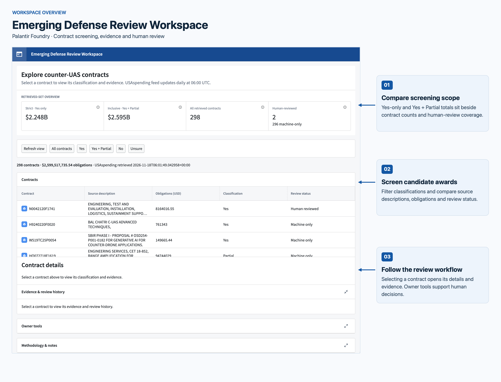

# Counter-UAS Market Screener | Palantir Foundry

[Product walkthrough](product%20walkthrough/) · [Technical implementation](technical%20implementation/)

This project uses Palantir Foundry to build a market screener for emerging defence technologies, connecting public procurement data with classification, supporting evidence and human review. Foundry was selected for its native data pipelines, Ontology and application-building tools, alongside AIP’s integration of AI into analytical workflows. Palantir’s work in defence and national security also made the platform relevant to the project’s subject. The screener is intended to help analysts identify relevant contract awards, examine the basis for each classification and understand how those judgements affect reported spending. The initial implementation focuses on counter-drone procurement.

The reporting makes those scope decisions visible. **Strict** sums awards classified Yes. **Inclusive** adds the full obligations of awards classified Partial, which cover counter-UAS alongside other missions. One radar award in the walkthrough carries **$94.7 million** of obligations across counter-UAS and rocket, artillery and mortar defence, with no allocation between missions in the description. A **$7,316.13** catering award for a counter-UAS workshop is classified No and falls outside both totals. Each award retains its source description and classification explanation for inspection.

Project delivery covered problem definition, the classification rubric, USAspending ingestion, Python data preparation, Ontology configuration, TypeScript application logic, Workshop interface design and release verification. The implementation keeps source facts, machine classifications, human decisions and calculated reporting values separate. Saved decisions retain their review-time source and proposal snapshots, allowing the basis for a judgement to remain inspectable as incoming data changes.

USAspending retrieval is scheduled daily at **06:00 UTC**, with an on-demand option. Python transforms retain eligible earlier proposals and apply deterministic rules to new or changed source context. Previously retrieved award keys remain in storage, while current search membership controls the standard application lists and totals. TypeScript gives a saved human label precedence, including Unsure, before calculating reporting membership. The **18 November 2026** overview shows **298 retrieved awards**, approximately **$2.600 billion** in obligations, **$2.248 billion Strict** and **$2.595 billion Inclusive**, with **two human-reviewed awards** and **296 machine-only awards**. These amounts describe the retrieved candidate set; Inclusive includes the whole obligation of each Partial award.

A source description containing **COUNTER- UNMANNED** exposed a spacing gap in the classifier. Both Python matchers were repaired and the same retrieved set was reprocessed. At the **28 October 2026** verification checkpoint, one award changed from Unsure to Yes, adding **$74,821** to both Strict and Inclusive. Checks compared prepared and indexed records and confirmed preservation of the two saved human decisions and their frozen snapshots. The Python repair passed **30 isolated regression checks**, with **eight additional method-compatibility checks**. The associated TypeScript application release passed **205/205 tests**.

The application was internally published as Workshop **v0.25.0** for a single-reviewer workflow. A separate AIP Logic prototype explored structured AI proposals, source-quotation validation and recorded proposal history using development fixtures. The recurring feed uses retained proposals and deterministic rules; automatic AIP classification of incoming awards is not implemented. This repository presents the application and its implementation through annotated screenshots.

The **product walkthrough** contains images **01–06**, covering screening, evidence and human review. **Technical implementation** contains images **07–14**, covering the supporting data workflow, application logic and AIP development prototype.

Data source — [USAspending.gov](https://www.usaspending.gov/).
